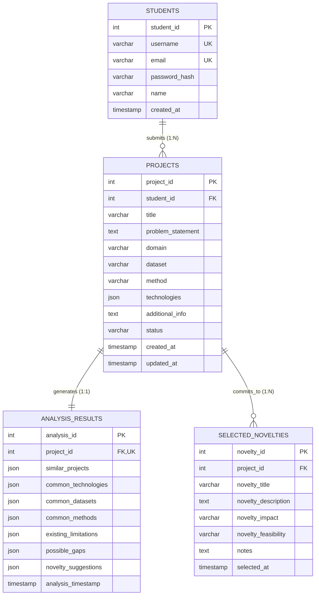

# PROJECT NOVELTY ADVISOR & MANAGEMENT SYSTEM
## DBMS Course Project — Review 1 Design & Progress Report

---

### Project Metadata & Team Details

* **Course Name:** Database Management Systems (DBMS) Course Project
* **Project Title:** Project Novelty Advisor & Management System
* **Faculty Guide / Reviewer:** Dr. Katari Balakrishna

#### Team Members:
| S.No | Student Name | Registration Number | Project Contribution |
|:---:|:---|:---:|:---|
| 1 | **Aarya Jadhav** | **25BCE2975** | Database Architecture, Schema Design & Backend Engine Integration |
| 2 | **Diya S** | **25BAI0235** | Novelty Scoring Logic, Component Saturation & Gap Analytics |
| 3 | **Hamsapriya V** | **25BCE2754** | Web Interface, Proposal Form Validation & User Workflows |

---

## 1. Executive Summary & Background

Every academic year, students in our university submit hundreds of capstone, mini-project, and course proposals. A common frustration for professors and evaluation committees is seeing the same topics submitted repeatedly across batches. For instance, almost every semester multiple teams propose predicting credit card fraud with logistic regression, classifying Iris flowers, or running sentiment analysis on Twitter data using BERT without any unique contribution or real engineering effort.

In most cases, students do not copy maliciously. They simply do not have visibility into past years' project archives, nor do they know how to take a familiar topic and push it further into something original. At the same time, faculty evaluators have to manually read through proposal submissions and try to remember whether a similar project was already evaluated last semester.

Existing tools do not address this problem:
* **Learning Management Systems (LMS)** like Moodle or Canvas store proposals as unindexed attachments without any originality checks.
* **Plagiarism checkers** like Turnitin only look for verbatim copied text. If two students describe the exact same architecture in different words, Turnitin shows 0% plagiarism.
* Traditional tools are strictly **punitive**—they reject proposals without giving constructive feedback on how to improve.

To solve this, we designed the **Project Novelty Advisor & Management System**. It is a database-backed web application built on MySQL and normalized in **Boyce-Codd Normal Form (BCNF)**. It stores student accounts, project proposals, similarity analytics, and committed novelty paths. Instead of just rejecting duplicate proposals, the system analyzes proposals across five structured dimensions (domain, method, dataset, tech stack, keywords), identifies saturated components, extracts research limitations, and gives students five concrete, practical suggestions to make their project original.

---

## 2. Problem Statement & Motivation

### 2.1 Real-World Problems We Are Addressing
1. **Topic Saturation in Academic Projects:** Students frequently re-implement textbook examples or past capstones without adding real technical or research value.
2. **High Cognitive Workload on Faculty:** Professors spend significant time cross-checking project titles and abstracts against past archives without any structured search or similarity tools.
3. **Lack of Constructive Guidance for Students:** When a proposal is turned down for being unoriginal, students are usually left without specific advice on how to improve its technical depth.
4. **Unstructured Historical Archives:** Past projects are scattered across Google Forms, spreadsheets, or physical folders, making it impossible to run queries or track technology trends over time.

### 2.2 What We Aim to Achieve in this Course Project
* **Robust Database Architecture:** Build a normalized, relational MySQL schema with primary keys, foreign keys, cascades, and indexes to manage proposals, analytics, and novelty choices.
* **Transparent Multi-Metric Scoring:** Implement an explainable scoring formula combining Jaccard set similarity and token matching across five specific project attributes.
* **Actionable Advisory Output:** Automatically generate five practical novelty pivots (e.g., cross-domain transfer, edge device optimization, hybrid methods, multimodal extensions) when high similarity is detected.
* **Proposal Lifecycle Tracking:** Track proposals through verified states (`submitted` → `analyzed` → `novelty_selected` → `approved`).

---

## 3. Literature Survey

### 3.1 Comparative Analysis Matrix

| System / Author | Core Technique | Key Strengths | Limitations & Gaps |
|:---|:---|:---|:---|
| **Salton & McGill (1983) Vector Space Models** | TF-IDF text vectors & cosine similarity | Fast lexical similarity; reliable baseline for raw text. | Treats text as an unstructured bag-of-words; misses structured attributes like datasets and tech stacks. |
| **Blei et al. (2003) Topic Modeling (LDA)** | Probabilistic Latent Dirichlet Allocation | Finds hidden topics across document collections. | Computationally heavy; probabilistic outputs lack deterministic explainability needed for academic grading. |
| **Turnitin / Urkund Plagiarism Checkers** | N-gram fingerprinting & string matching | Industry standard for detecting word-for-word copying. | **Strictly punitive**; cannot detect when different words are used to describe an identical software pipeline. |
| **Traditional Academic LMS (Moodle, Canvas)** | Relational CRUD database with file attachments | Manages submissions, student accounts, and gradebooks. | Zero analytical intelligence; proposals are stored as unindexed static files without semantic search. |
| **Our Proposed System: Project Novelty Advisor** | Normalized Relational DB + Multi-Metric Jaccard & Rule-Based Advisory | Relational integrity (BCNF), component saturation detection, transparent scoring, and actionable suggestions. | Currently rule-based (planned to add dense vector embeddings in Review 3). |

### 3.2 Key Insights from Literature
* **Separating Project Attributes:** A key lesson from Salton & McGill is that comparing an entire project description as one block of text loses critical details. For example, a student using an established algorithm on a brand-new dataset is very different from a student copying both the algorithm and the dataset. By breaking proposals into domain, method, dataset, tech stack, and keywords, we evaluate originality accurately.
* **Using Jaccard Similarity for Tech Stacks:** Paul Jaccard's set similarity metric (1912) is ideal for comparing programming languages, frameworks, and libraries: $J(A, B) = \frac{|A \cap B|}{|A \cup B|}$. Order does not matter, making it clean and scale-invariant.
* **Hybrid Relational-JSON Storage:** As highlighted by Elmasri & Navathe (2015), relational schemas offer strong ACID guarantees, while JSON data types handle dynamic analytical arrays without requiring bloated artificial columns.

---

## 4. What is Novel in This Project?

1. **Constructive Advice Instead of Rejection:**
   * Plagiarism checkers say: *"Similarity is 70%, proposal rejected."*
   * Our system says: *"Your proposal has 70% similarity because BERT + Twitter Dataset for Sentiment Analysis is heavily overused. Here are 5 ways to make it original: (1) Test on low-resource regional languages; (2) Optimize for edge devices using MobileBERT; (3) Incorporate audio-text multimodal signals."*
2. **Transparent 5-Dimensional Decomposition:**
   * We evaluate proposals along five distinct axes:
     - **Domain ($25\%$)**
     - **Method ($25\%$)**
     - **Dataset ($20\%$)**
     - **Tech Stack ($15\%$)**
     - **Problem Keywords ($15\%$)**
   * This makes the similarity score fully explainable to students and faculty.
3. **Saturation & Gap Discovery:**
   * The system aggregates historical submissions to flag components that exceed frequency limits and extracts known limitations from previous projects.
4. **Verifiable Novelty Commitment:**
   * When a student selects a novelty suggestion, it is saved directly into the database (`selected_novelties`). This creates an agreed-upon baseline that faculty guides can verify during Review 2 and Final Review.

---

## 5. Technical & DBMS Challenges Addressed

1. **Balancing Relational Structure with Variable Analytical Outputs:**
   * Student profiles and project headers require strict relational normalization (BCNF). However, the number of similar projects and suggestions changes with each run.
   * *Solution:* We engineered a hybrid schema: standard relational tables for core records, paired with native MySQL JSON columns for flexible analytical payloads.
2. **Preventing Search Bottlenecks:**
   * Running SQL `LIKE '%keyword%'` across hundreds of problem statement paragraphs causes slow full table scans ($O(N)$).
   * *Solution:* We added MySQL `FULLTEXT` indexes on project titles and problem statements to enable rapid keyword lookups.
3. **Maintaining Clean Referential Integrity:**
   * If a student account is removed or a proposal is deleted, child records should never be left orphaned.
   * *Solution:* We enforced strict foreign key constraints with `ON DELETE CASCADE` across all child tables.
4. **Secure Password Storage:**
   * To protect user credentials, student passwords are encrypted using salted PBKDF2 hashing (via Werkzeug) before being stored in the database.

---

## 6. System Architecture & Workflows

### 6.1 Three-Tier System Architecture
Our system is organized as a decoupled three-tier architecture:
* **Tier 1 (Presentation):** Streamlit Web Interface (Student Login, Project Submission Form, Novelty Dashboard, and Selection UI).
* **Tier 2 (Application & Intelligence):** Flask REST API (`backend.py`) and Novelty Engine (`novelty_engine.py`) handling validation, attribute extraction, multi-metric scoring, and idea generation.
* **Tier 3 (Database):** MySQL InnoDB engine storing normalized BCNF tables with ACID transaction guarantees.

```
┌────────────────────────────────────────────────────────┐
│               PRESENTATION LAYER (Streamlit)            │
│  - Student Authentication & Dashboard                  │
│  - Project Proposal Submission Interface               │
│  - Interactive Novelty Analytics & Gap Visualizer      │
└───────────────────────────┬────────────────────────────┘
                            │ REST API Calls (HTTP / JSON)
                            ▼
┌────────────────────────────────────────────────────────┐
│             APPLICATION LAYER (Flask Backend)           │
│  - REST Endpoints (/api/auth, /api/projects, etc.)     │
│  - Request Validation & Session Handling               │
│  - Transaction Control & Error Handling                │
└─────────────┬────────────────────────────┬─────────────┘
              │ Invokes                    │ Executes SQL
              ▼                            ▼
┌───────────────────────────┐  ┌─────────────────────────┐
│     NOVELTY ENGINE        │  │     DATA TIER (MySQL)   │
│  - Attribute Normalizer   │  │  - InnoDB ACID Storage  │
│  - Weighted Similarity    │  │  - Foreign Key Cascades │
│  - Component Analyzer     │  │  - FULLTEXT Indexes     │
│  - Gap & Idea Generator   │  │  - JSON Doc Stores      │
└───────────────────────────┘  └─────────────────────────┘
```

### 6.2 Algorithmic Scoring Formula

$$S_{total} = \left( 0.25 \cdot S_{domain} + 0.25 \cdot S_{method} + 0.20 \cdot S_{dataset} + 0.15 \cdot S_{tech} + 0.15 \cdot S_{keywords} \right) \times 100$$

* $S_{domain} \in \{0.0, 0.5, 1.0\}$: Case-insensitive domain match.
* $S_{method}, S_{dataset} \in [0.0, 1.0]$: Normalized token overlap and exact string matching.
* $S_{tech} = \frac{|T_{new} \cap T_{archived}|}{|T_{new} \cup T_{archived}|}$: Jaccard similarity across technical stacks.
* $S_{keywords} = \frac{|K_{new} \cap K_{archived}|}{|K_{new} \cup K_{archived}|}$: Jaccard similarity over non-stopword tokens.
* **Cutoff Threshold ($\tau = 0.30$):** Past projects scoring $\ge 30\%$ are retrieved and ranked.

---

## 7. DBMS Architectural Design & Implementation

### 7.1 Entity-Relationship (ER) Schema



---

### 7.2 Relational Data Dictionary & Normalization Study (BCNF / 3NF)

#### **Table 1: `students` (Student User Accounts & Credentials)**

| Attribute / Column | SQL Data Type | Keys & Constraints | Role & Description |
|:---|:---|:---|:---|
| `student_id` | INT | PRIMARY KEY, AUTO_INCREMENT | Unique surrogate key identifying each student. |
| `username` | VARCHAR(100) | UNIQUE, NOT NULL | Unique handle used for login. |
| `email` | VARCHAR(100) | UNIQUE, NOT NULL | Student institutional email address. |
| `password_hash` | VARCHAR(255) | NOT NULL | Salted PBKDF2 cryptographic password digest. |
| `name` | VARCHAR(100) | NOT NULL | Full student name for official academic records. |
| `created_at` | TIMESTAMP | DEFAULT CURRENT_TIMESTAMP | Timestamp when the account was registered. |

* **Candidate Keys:** $\{\text{student\_id}\}$, $\{\text{username}\}$, $\{\text{email}\}$
* **Functional Dependencies:**
  - $FD_1: \text{student\_id} \to \{\text{username}, \text{email}, \text{password\_hash}, \text{name}, \text{created\_at}\}$
  - $FD_2: \text{username} \to \{\text{student\_id}, \text{email}, \text{password\_hash}, \text{name}, \text{created\_at}\}$
  - $FD_3: \text{email} \to \{\text{student\_id}, \text{username}, \text{password\_hash}, \text{name}, \text{created\_at}\}$
* **Normalization Proof:**
  - **1NF:** All columns store atomic, scalar values. No repeating fields.
  - **2NF:** All candidate keys are single attributes (no composite keys), making partial dependencies impossible.
  - **3NF:** No non-prime attribute determines any other non-prime attribute; zero transitive dependencies.
  - **BCNF:** In all three FDs, the determinants (`student_id`, `username`, `email`) are candidate keys and superkeys.
  - $\implies$ **Strictly in Boyce-Codd Normal Form (BCNF)**.

---

#### **Table 2: `projects` (Project Proposals & Metadata)**

| Attribute / Column | SQL Data Type | Keys & Constraints | Role & Description |
|:---|:---|:---|:---|
| `project_id` | INT | PRIMARY KEY, AUTO_INCREMENT | Unique surrogate key for each project proposal. |
| `student_id` | INT | FOREIGN KEY, NOT NULL | References `students(student_id)` with `ON DELETE CASCADE`. |
| `title` | VARCHAR(255) | NOT NULL, FULLTEXT INDEX | Proposed project title. |
| `problem_statement` | TEXT | NOT NULL, FULLTEXT INDEX | Problem statement description written by the student. |
| `domain` | VARCHAR(100) | NULLABLE | Broad domain (e.g., Computer Vision, NLP, IoT). |
| `dataset` | VARCHAR(255) | NULLABLE | Name of the target dataset or benchmark. |
| `method` | VARCHAR(255) | NULLABLE | Target methodology or model (e.g., YOLOv8, ResNet). |
| `technologies` | JSON | NULLABLE | Array of libraries/frameworks (e.g., `["PyTorch", "OpenCV"]`). |
| `additional_info` | TEXT | NULLABLE | Supplementary notes and hardware/deployment details. |
| `status` | VARCHAR(50) | DEFAULT 'submitted' | Status: `submitted`, `analyzed`, `novelty_selected`, `approved`. |
| `created_at` | TIMESTAMP | DEFAULT CURRENT_TIMESTAMP | Submission timestamp. |
| `updated_at` | TIMESTAMP | ON UPDATE CURRENT_TIMESTAMP | Timestamp of last status update or edit. |

* **Candidate Key:** $\{\text{project\_id}\}$
* **Foreign Key:** `student_id` references `students(student_id)` `ON DELETE CASCADE`
* **Functional Dependencies:**
  - $FD_1: \text{project\_id} \to \{\text{student\_id}, \text{title}, \text{problem\_statement}, \text{domain}, \text{dataset}, \text{method}, \text{technologies}, \text{additional\_info}, \text{status}, \text{created\_at}, \text{updated\_at}\}$
* **Normalization Proof:**
  - **1NF:** Atomic scalar attributes; technologies stored as native JSON document object.
  - **2NF:** In 1NF and candidate key is a single attribute (`project_id`), precluding partial dependencies.
  - **3NF:** No transitive dependency $X \to Y$ where $Y$ is non-prime and $X$ is not a superkey.
  - **BCNF:** The sole determinant (`project_id`) is the candidate key and superkey.
  - $\implies$ **Strictly in Boyce-Codd Normal Form (BCNF)**.

---

#### **Table 3: `analysis_results` (Analytical Similarity Output)**

| Attribute / Column | SQL Data Type | Keys & Constraints | Role & Description |
|:---|:---|:---|:---|
| `analysis_id` | INT | PRIMARY KEY, AUTO_INCREMENT | Unique surrogate key for each analysis result. |
| `project_id` | INT | FOREIGN KEY, UNIQUE, NOT NULL | References `projects(project_id)` `ON DELETE CASCADE` (1:1). |
| `similar_projects` | JSON | NULLABLE | Top 5 similar historical projects with percentage similarity. |
| `common_technologies` | JSON | NULLABLE | Overused technologies and institutional usage rates. |
| `common_datasets` | JSON | NULLABLE | Overused datasets and frequency statistics. |
| `common_methods` | JSON | NULLABLE | Overused algorithms and frequency statistics. |
| `existing_limitations` | JSON | NULLABLE | Known literature limitations of matching projects. |
| `possible_gaps` | JSON | NULLABLE | Research gaps and improvement opportunities. |
| `novelty_suggestions` | JSON | NULLABLE | 5 algorithmically generated novelty ideas with impact/feasibility. |
| `analysis_timestamp` | TIMESTAMP | DEFAULT CURRENT_TIMESTAMP | Timestamp when the analysis engine executed. |

* **Candidate Keys:** $\{\text{analysis\_id}\}$, $\{\text{project\_id}\}$ (enforced via `UNIQUE` constraint)
* **Functional Dependencies:**
  - $FD_1: \text{analysis\_id} \to \{\text{project\_id}, \text{similar\_projects}, \text{common\_technologies}, \dots, \text{analysis\_timestamp}\}$
  - $FD_2: \text{project\_id} \to \{\text{analysis\_id}, \text{similar\_projects}, \text{common\_technologies}, \dots, \text{analysis\_timestamp}\}$
* **Normalization Proof:**
  - **1NF, 2NF, 3NF:** Fully satisfied with atomic keys and zero transitive dependencies.
  - **BCNF:** Both determinants (`analysis_id`, `project_id`) are candidate keys.
  - $\implies$ **Strictly in Boyce-Codd Normal Form (BCNF)**.

---

#### **Table 4: `selected_novelties` (Student Roadmap Commitment)**

| Attribute / Column | SQL Data Type | Keys & Constraints | Role & Description |
|:---|:---|:---|:---|
| `novelty_id` | INT | PRIMARY KEY, AUTO_INCREMENT | Unique surrogate key for the selected novelty record. |
| `project_id` | INT | FOREIGN KEY, NOT NULL | References `projects(project_id)` `ON DELETE CASCADE`. |
| `novelty_title` | VARCHAR(255) | NULLABLE | Title of the student's chosen novelty enhancement. |
| `novelty_description` | TEXT | NULLABLE | Technical specification of the chosen novelty pivot. |
| `novelty_impact` | VARCHAR(50) | NULLABLE | Expected academic/practical impact rating (`'High'`, `'Medium'`). |
| `novelty_feasibility` | VARCHAR(50) | NULLABLE | Implementation feasibility rating (`'High'`, `'Medium'`). |
| `notes` | TEXT | NULLABLE | Student implementation notes and planned milestones. |
| `selected_at` | TIMESTAMP | DEFAULT CURRENT_TIMESTAMP | Timestamp when student locked in the selection. |

* **Candidate Key:** $\{\text{novelty\_id}\}$
* **Functional Dependencies:**
  - $FD_1: \text{novelty\_id} \to \{\text{project\_id}, \text{novelty\_title}, \text{novelty\_description}, \text{novelty\_impact}, \text{novelty\_feasibility}, \text{notes}, \text{selected\_at}\}$
* **Normalization Proof:** The determinant (`novelty_id`) is the primary key $\implies$ **BCNF**.

---

### 7.3 Data Definition Language (DDL) Specification

```sql
-- 1. Students Table
CREATE TABLE IF NOT EXISTS students (
    student_id INT AUTO_INCREMENT PRIMARY KEY,
    username VARCHAR(100) UNIQUE NOT NULL,
    email VARCHAR(100) UNIQUE NOT NULL,
    password_hash VARCHAR(255) NOT NULL,
    name VARCHAR(100) NOT NULL,
    created_at TIMESTAMP DEFAULT CURRENT_TIMESTAMP
) ENGINE=InnoDB DEFAULT CHARSET=utf8mb4;

-- 2. Projects Table
CREATE TABLE IF NOT EXISTS projects (
    project_id INT AUTO_INCREMENT PRIMARY KEY,
    student_id INT NOT NULL,
    title VARCHAR(255) NOT NULL,
    problem_statement TEXT NOT NULL,
    domain VARCHAR(100),
    dataset VARCHAR(255),
    method VARCHAR(255),
    technologies JSON,
    additional_info TEXT,
    status VARCHAR(50) DEFAULT 'submitted',
    created_at TIMESTAMP DEFAULT CURRENT_TIMESTAMP,
    updated_at TIMESTAMP DEFAULT CURRENT_TIMESTAMP ON UPDATE CURRENT_TIMESTAMP,
    FOREIGN KEY (student_id) REFERENCES students(student_id) ON DELETE CASCADE,
    INDEX idx_student_id (student_id),
    INDEX idx_status (status),
    FULLTEXT INDEX ft_title (title),
    FULLTEXT INDEX ft_problem (problem_statement)
) ENGINE=InnoDB DEFAULT CHARSET=utf8mb4;

-- 3. Analysis Results Table
CREATE TABLE IF NOT EXISTS analysis_results (
    analysis_id INT AUTO_INCREMENT PRIMARY KEY,
    project_id INT NOT NULL UNIQUE,
    similar_projects JSON,
    common_technologies JSON,
    common_datasets JSON,
    common_methods JSON,
    existing_limitations JSON,
    possible_gaps JSON,
    novelty_suggestions JSON,
    analysis_timestamp TIMESTAMP DEFAULT CURRENT_TIMESTAMP,
    FOREIGN KEY (project_id) REFERENCES projects(project_id) ON DELETE CASCADE,
    INDEX idx_project_id (project_id)
) ENGINE=InnoDB DEFAULT CHARSET=utf8mb4;

-- 4. Selected Novelties Table
CREATE TABLE IF NOT EXISTS selected_novelties (
    novelty_id INT AUTO_INCREMENT PRIMARY KEY,
    project_id INT NOT NULL,
    novelty_title VARCHAR(255),
    novelty_description TEXT,
    novelty_impact VARCHAR(50),
    novelty_feasibility VARCHAR(50),
    notes TEXT,
    selected_at TIMESTAMP DEFAULT CURRENT_TIMESTAMP,
    FOREIGN KEY (project_id) REFERENCES projects(project_id) ON DELETE CASCADE,
    INDEX idx_project_id (project_id)
) ENGINE=InnoDB DEFAULT CHARSET=utf8mb4;
```

---

## 8. Review 1 Implementation Status & Testing

| System Component | Source Deliverable | Verification Status |
|:---|:---|:---|
| **Database Setup** | [setup_database.py](file:///Users/aarya20067/Documents/projects%20/project-novelty-detector/setup_database.py) | **Completed:** All 4 tables created with indexes, cascades, and sample data. |
| **Novelty Engine** | [novelty_engine.py](file:///Users/aarya20067/Documents/projects%20/project-novelty-detector/novelty_engine.py) | **Completed:** Attribute extractor, 5-metric similarity analyzer, and idea generator verified. |
| **Flask REST Server** | [backend.py](file:///Users/aarya20067/Documents/projects%20/project-novelty-detector/backend.py) | **Completed:** 10 REST endpoints implemented for authentication, submission, and analytics. |
| **Streamlit Web App** | [app_single_file.py](file:///Users/aarya20067/Documents/projects%20/project-novelty-detector/app_single_file.py) / [app.py](file:///Users/aarya20067/Documents/projects%20/project-novelty-detector/app.py) | **Completed:** 8 interactive pages (Dashboard, Submit, Results, Novelties, My Projects). |
| **Automated Tests** | [test_complete_workflow.py](file:///Users/aarya20067/Documents/projects%20/project-novelty-detector/test_complete_workflow.py) | **Verified:** Full end-to-end integration test passes successfully. |
| **Version Control** | GitHub Repository | **Completed:** Project synced on GitHub at [Project-Novelty-Advisor-Management-System](https://github.com/jaarya2379-maker/Project-Novelty-Advisor-Management-System). |

---

## 9. Project Roadmap & Future Scope

### Review 2 Goals:
1. **Live MySQL Connection in Frontend:** Connect the Streamlit interface dynamically to the running Flask backend endpoints, moving from session data to persistent MySQL transactions.
2. **Faculty Reviewer Dashboard:** Add a dedicated role for professors to view submitted proposals, review student-selected novelties, and approve or request revisions.
3. **Database Audit Logging:** Implement MySQL triggers on the `projects` table to automatically log all status updates and timestamps into an audit table (`project_audit_log`).

### Review 3 Goals:
1. **Dense Sentence Embeddings:** Integrate Sentence-BERT embeddings to compare semantic problem meanings beyond exact keyword tokens.
2. **PDF Novelty Dossier Export:** Add an automated download button in Streamlit to generate a formal PDF novelty certificate for grading records.
3. **JWT Role-Based Access Control:** Implement JSON Web Tokens (JWT) for secure session management between frontend and backend.

---

## 10. References (IEEE Format)

1. G. Salton and M. J. McGill, *Introduction to Modern Information Retrieval*. New York: McGraw-Hill, 1983.
2. R. Elmasri and S. B. Navathe, *Fundamentals of Database Systems*, 7th ed. Hoboken, NJ: Pearson, 2015.
3. A. Silberschatz, H. F. Korth, and S. Sudarshan, *Database System Concepts*, 7th ed. New York: McGraw-Hill Education, 2019.
4. D. M. Blei, A. Y. Ng, and M. I. Jordan, "Latent Dirichlet Allocation," *Journal of Machine Learning Research*, vol. 3, pp. 993–1022, 2003.
5. T. Lancaster and F. Culwin, "Investigations into plagiarism detection systems: The development of an electronic tool to facilitate the detection of contract cheating," *Research in Education*, vol. 74, no. 1, pp. 10–24, 2005.
6. P. Jaccard, "The distribution of the flora in the alpine zone," *New Phytologist*, vol. 11, no. 2, pp. 37–50, 1912.
7. N. Reimers and I. Gurevych, "Sentence-BERT: Sentence Embeddings using Siamese BERT-Networks," in *Proc. Conf. Empirical Methods in Natural Language Processing (EMNLP)*, 2019.
8. *MySQL 8.0 Reference Manual*, JSON Data Type, Indexes, and InnoDB Architecture, Oracle Corporation, 2024.
